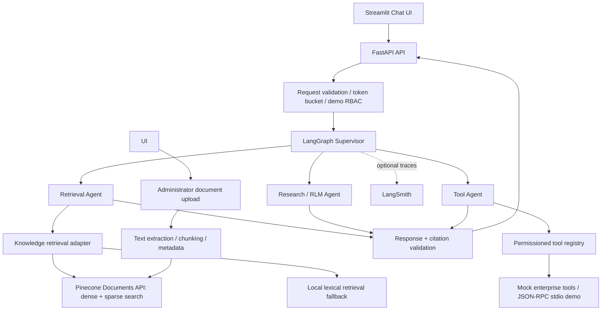

# Architecture and Design Decisions

## System flow

## Nodes and responsibilities

- **Supervisor:** classifies intent, chooses a bounded route and blocks obvious prompt-injection attempts before tools run.
- **Retrieval:** uses Pinecone dense+sparse hybrid search with OpenRouter embeddings when `USE_PINECONE=true`; otherwise it uses the local lexical/term-overlap fallback. Sample-document ingestion is provided by `python -m app.ingest`.
- **Research/RLM:** creates a bounded search plan, retrieves relevant documents, partitions evidence into small batches, runs per-batch LLM sub-analysis in live mode, and supplies batch analyses plus evidence to the final aggregation node. It does not execute arbitrary LLM-generated Python; generated code execution would require a sandbox.
- **Tool agent:** calls named tools from a registry, with permission checks before execution. The enterprise tools in this assessment are mock/demo integrations; the included stdio JSON-RPC server is a minimal demonstration, not a production MCP deployment.
- **Response:** uses OpenRouter chat completions in live mode and validates citations against retrieved source IDs. Mock mode is an explicit offline-only setting; live failures are surfaced instead of silently generating fake answers.

## Security model

1. Validate request shape, length and allowed characters.
2. Apply a per-user token bucket.
3. Resolve the supplied demo `user_id` through the server-side `DEMO_USER_ROLES` mapping and reject unknown demo users or submitted-role mismatches.
4. Check tool permissions in server code immediately before tool execution.
5. Apply document access-level metadata filters before retrieved evidence is returned to the graph.
6. Treat retrieved text as untrusted data; it cannot change system policy.
7. Validate source IDs and remove unverified citation markers.
8. Do not log secrets or full sensitive document payloads.

**Assessment limitation:** the demo role is checked against a server-side mapping, but the `user_id` itself is still supplied by the client. This is not secure authentication and must not be used to protect real enterprise data. Production must derive identity and roles from verified OIDC/JWT claims or an equivalent authenticated session, use least-privilege service credentials, and use Redis or another shared store for rate limits/session state across replicas.

**Department-filter limitation:** uploaded documents store department metadata, and the retrieval function supports an optional department filter. The current LangGraph chat workflow does not propagate a user's department into retrieval calls. Therefore, department-level isolation is not fully enforced end-to-end in chat and must not be claimed as a completed security control.

## Memory

- Session state stores recent user question/assistant answer pairs in process memory, and a bounded subset is passed to the graph.
- It is session-scoped, bounded and volatile; restart loses it. Do not store secrets in memory.
- Production: encrypted Redis/Postgres with TTL, tenant/user/session scoping, retention controls, deletion API, and audit logs. Long-term memory should require explicit purpose and privacy controls.

## Observability

When `LANGCHAIN_TRACING_V2=true` and `LANGCHAIN_API_KEY` are configured, LangSmith tracing can capture graph runs and node activity. Do not include credentials or sensitive customer data in trace metadata. Verify traces in the configured LangSmith project during the demo.

## Async and failure handling

- The FastAPI chat endpoint is async; synchronous graph invocation is offloaded with `asyncio.to_thread` to avoid blocking the event loop.
- Provider errors surface as controlled service errors; deterministic mock output is used only when `MOCK_MODE=true`.
- The token bucket returns 429 with retry guidance.
- Production improvements: native async graph streaming, async Pinecone calls, retries with exponential backoff, circuit breakers, shared rate limits and OpenTelemetry metrics.

## Pinecone hybrid retrieval and ingestion

1. `python -m app.ingest` chunks sample Markdown files and obtains dense vectors from the configured OpenRouter embedding model.
2. It generates BM25-style sparse lexical vectors and upserts dense+sparse document records with source/document metadata into the configured Pinecone namespace.
3. At query time, `app.knowledge` embeds the question, generates a sparse query representation, applies access-level filters and an optional department filter, and searches Pinecone.
4. Results are mapped to retrieval records and deduplicated by source document before being returned for citation validation.
5. The configured embedding model, `openai/text-embedding-3-small`, produces 1536-dimensional vectors. The Pinecone index dimension must match; re-ingest after changing the embedding model or index configuration.

## Uploaded-document ingestion

1. An administrator demo user uploads a supported PDF, DOCX, TXT, or Markdown file through the Streamlit interface.
2. FastAPI validates the demo identity and upload metadata.
3. The ingestion layer extracts text, chunks it, and attaches document metadata such as department, document type, and access level.
4. With `USE_PINECONE=true`, chunks are embedded and upserted into the configured Pinecone namespace. With local fallback enabled, uploaded content is held in backend process memory and is lost when the backend restarts.
5. Scanned PDFs require OCR before upload.

The ZIP includes integration code but cannot provision cloud resources or credentials. Validate ingestion, retrieval, and access-level behavior against your own Pinecone and OpenRouter accounts before describing cloud retrieval as live in the assessment.
